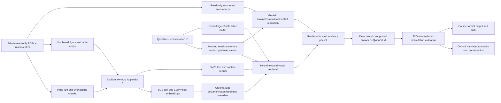

# Part 1 architecture: report draft

Named-chart questions bypass table-only structured resolution. Corrected and
original chart labels retain distinct identities. The baseline replaces the
hybrid/explicit-label retrieval path with dense BGE and CLIP retrieval and
disables global structured-fact expansion; other model/decoding/validation
settings are shared. This is an end-to-end comparison rather than an isolated
BM25 ablation. Frozen references never enter the inference question objects.

All experiment measurements come from the executed inference and metrics
notebooks. Retrieval runs on CPU and generation on one CUDA device. Original
inputs, databases and checkpoints stay outside version control. See the protocol,
compatibility history, safety draft and measured report for observed limits.
