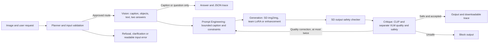

# Part 3 system card and safety-analysis draft

AI-assisted factual draft. Both members must review, rewrite in their own words,
complete the independent judgments and integrate this into their IEEE report.
This is not a completed course submission or a claim of human approval.

## Capabilities and architecture

The local application captions images, answers visual questions, transforms
artistic style with SD1.5 img2img, applies the pinned team Part2 LoRA for domain
style, and performs photometric enhancement without resynthesizing the scene.
Vision and image review use the pinned Qwen2.5-VL-3B model. CLIP ViT-B/32 runs
on CPU and supplies an unscaled image/text cosine diagnostic. No hosted model
API is used by this inference pipeline. Initial model weights come from Hugging Face.

One typed dataclass carries workflow state. Timed input/output events and raw
format attempts are saved locally, including failed requests. Each revised image
starts from the original source. At the revision bound, the output is explicitly
marked as having unresolved quality issues rather than silently accepted.

## Guardrails and trust boundaries

The Planner validates file format, readability, size and image dimensions; rejects
unsafe generation and deceptive real-person edits; and asks for clarification
when the supported operation is unclear. Its regular expressions are a transparent
baseline and can miss paraphrases. Image text is never promoted into routing,
tools or higher-priority instructions. Prompt construction uses sanitized object
labels and caption context, bounded model output, approved user constraints and
the actual diffusion tokenizer limit. Model prose never controls executable tools.

All image routes require the existing SD safety checker, then separate VLM safety
and quality objects. Safety and image quality are distinct: wrong objects, count,
color, text or weak style cause revision, not a fabricated unsafe-content category.
Missing/unsafe safety results block presentation. Explicit monochrome conversion
is recorded and checked again. Both quality-loop conditions retain output safety.
The app binds only to localhost, with no public share link. Portrait consent and
local-only restrictions remain in force. Rejected portrait inputs are excluded
from independent review galleries and all code packages exclude images and data.

## Evidence boundaries and observed limitations

The measured report is generated by the executed notebook from real RTX4090 run
records. Frozen requests, rubrics and private inputs are unchanged. Earlier failures
and failed validator attempts remain archived. Development fixes followed inspection
of earlier failures, so these runs must not be presented as an untouched holdout.

Observed limits include missed or weak artistic transformations, changed details,
hallucinated objects or text, and critic false accepts. Higher img2img strength
trades preservation against visible style. Photometric enhancement preserves pixel
geometry but can still change legibility or color in undesirable ways. The VLM
and SD safety models can both miss unsafe content or reject benign content. A high
CLIP cosine does not establish correct counts, text, artistic style or safety.

Insert the notebook-generated per-case red-team observations here only after both
members independently inspect them. Operational refusal/block/error counts are not
attack-success rates. Task success, human agreement, attack success and critic
agreement remain pending until complete real reviews and documented adjudication.
The earlier RTX 4090 allocator-budget run is separate from the completed Colab
Tesla T4 execution recorded in the Part 3 notebook and measured T4 report.
Both members' independent reviews, meeting recordings, final report, artifact
hosting, publication and final tag remain separate submission obligations.
