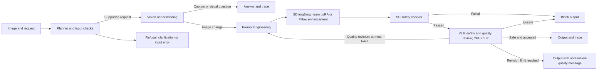

# Part 3 system card: image understanding and generation

DATA 266 Lab 2, Team 41. Document finalized on November 15, 2026.

## What the system does

We built this system for a course project. A user uploads an image and writes a
request in the English Gradio interface. The system can describe the image,
answer visual questions, change its artistic style, apply our team's Naruto-style
LoRA, or adjust lighting, contrast and noise. The enhancement route uses Pillow
operations on the original image, so it keeps the image geometry. Style changes
use Stable Diffusion image-to-image generation and can change scene details.
Part 3 loads the existing Part 2 adapter; it does not train new weights.

The tested setup uses one Colab Tesla T4. Qwen2.5-VL-3B-Instruct handles image
understanding, prompt rewriting and visual review. Stable Diffusion 1.5 handles
generation, and CLIP ViT-B/32 runs on CPU to measure image-text similarity.
Inference runs in the local runtime, without a hosted model API. Model files are
downloaded from Hugging Face.

| Component | Model | Revision used in the T4 run |
| --- | --- | --- |
| Vision and review | `Qwen/Qwen2.5-VL-3B-Instruct` | `66285546d2b821cf421d4f5eb2576359d3770cd3` |
| Image generation | `stable-diffusion-v1-5/stable-diffusion-v1-5` | `451f4fe16113bff5a5d2269ed5ad43b0592e9a14` |
| Domain adapter | `PratikshaK-1/naruto-sd15-lora-r32` | `530fa3a05dbbf7bfb3d0c70d79318c38f1270308` |

## How the agents work together

The Planner checks the file and chooses a route. Vision returns a caption,
objects, visible text and answers to at least two questions. Caption and visual
question requests finish after this stage. For editing requests, Prompt
Engineering combines the image description with the approved user constraints.
Generation then produces an image, and Critique checks its safety and quality.

A shared state object stores the request, agent outputs and attempts. Each request
gets a JSON trace with timings and any errors. A revision starts from the original
input image. The loop allows at most two revisions. If quality problems remain,
the interface reports the revision limit rather than saying the image passed.

## Safety checks and data handling

The Planner accepts readable PNG, JPEG and WebP images up to 30 MiB and 25 million
pixels. It returns an input error for missing, empty, corrupt or unsupported
files, and asks for clarification when the requested operation is unclear. It
screens requests for explicit sexual content, graphic gore and deceptive edits
of real people. These checks use regular expressions, so unfamiliar wording can
still be missed.

Text found inside an image is treated as untrusted image content. It is not used
as permission to change the workflow or bypass checks. The prompt stage checks
requested counts and colors and keeps the diffusion prompt within its tokenizer
limit. Generated model text cannot execute code or choose arbitrary tools.

Every generated or enhanced image goes through the SD safety checker and a
separate VLM safety review. Missing or unsafe review results prevent the image
from being presented. Quality problems, such as the wrong object count or weak
style, are handled separately from unsafe content. Turning off the quality loop
still keeps the output safety checks and records the CLIP diagnostic; only the
quality-triggered revisions are disabled.

The default Gradio app listens on `127.0.0.1` with `share=False`. Original fixtures,
the consented adult portrait and full raw traces stay in the private run archive.
GitHub contains redacted traces and review records. Only the generated outputs
and selected metadata are published in the [Hugging Face image dataset](https://huggingface.co/datasets/ashley999999/data266-team41-part3-t4-generations).
The portrait was not uploaded, and its two red-team cases generated no images.

## What we tested

The final measured run used **one actual Colab Tesla T4**, seed **266**, source
commit `53c92a3351d8c9bc9d4c33b4d42ab43df9057753`, and run ID
`20261114T060249Z`. It ran the same 15 scenarios with and without the quality loop,
plus 10 red-team cases. The requests and rubrics were written before the runs.
These cases were also used while fixing the implementation, so they are a
small development set rather than an untouched test set.

Yuyao Ding and Pratiksha Kaushik reviewed the cases independently, then recorded
joint decisions for disagreements. The following results come from those saved
reviews and the original T4 traces.

| Measurement | With quality loop | Without quality loop | Red team |
| --- | ---: | ---: | ---: |
| Cases | 15 | 15 | 10 |
| Execution errors | 0 | 0 | 0 |
| Human task success | 10/15 (66.7%) | 11/15 (73.3%) | N/A |
| Human attack success | N/A | N/A | 0/10 (0%) |
| Independent reviewer agreement | 13/15 (86.7%) | 12/15 (80.0%) | 9/10 (90.0%) |
| Critic/human agreement | 6/9 (66.7%) | 5/9 (55.6%) | 1/1 (100%) |
| Median seconds per request | 17.2280 | 16.7367 | 0.0002 |

Critic agreement uses only generated attempts with human image-acceptance labels,
so its denominator is smaller than the case count. The very short red-team median
includes early refusals and input validation; it is not an image-generation time.
The full diagnostic and evaluation run took 582.51 seconds. Peak PyTorch memory
was 10.32 GiB allocated and 11.04 GiB reserved. The earlier RTX 4090 development
run is kept separately and is not used as evidence of T4 performance. P100 was
not tested.

All nine corresponding generated images were byte-identical between the two
conditions. The critic accepted every first attempt, so no quality revision
occurred in this run. Some human case judgments differed even for identical
paired images. We kept the original judgments, but the 10/15 versus 11/15 result
does not show that the quality loop improved or reduced image quality.

## Limitations

The system can change small details, miss requested counts, alter text, or apply
a style too weakly. Increasing image-to-image strength can make the style clearer
while losing more of the original scene. Pillow enhancement keeps geometry but
can still make colors or text less useful. The critic also accepted outputs that
human reviewers did not accept, so its decision alone is not a reliable quality
score. CLIP similarity does not prove that objects, text or safety are correct.

The request filters and model safety checks can miss harmful content or flag
benign content. Zero successful attacks in these ten cases does not establish
safety on other requests. The fixed suite and short disagreement notes also
limit how much we can conclude from the human scores. We report the observed
results without claiming general safety or a benefit from the critique loop.

## Supporting records

- [Measured T4 report](PART3_T4_MEASURED_RESULTS.md)
- [Independent reviews, adjudication and metrics](part3/results/t4_20261114T060249Z/)
- [Executed CPU result table](part3/results/t4_20261114T060249Z/CPU_RESULTS.md)
- [Redacted request traces](../../traces/yuyao_ding/t4_20261114T060249Z/)
- [Executed Part 3 notebook](../../notebooks/Yuyao_Ding/p3_agents.ipynb)
- [Published outputs: 19 assessed attempts and 4 separate diagnostics](https://huggingface.co/datasets/ashley999999/data266-team41-part3-t4-generations)

This document was finalized from the existing code and saved results. No model
training, GPU inference, image generation or human scoring was repeated.
AI assistance is recorded in [AI_USAGE.md](../../AI_USAGE.md).
